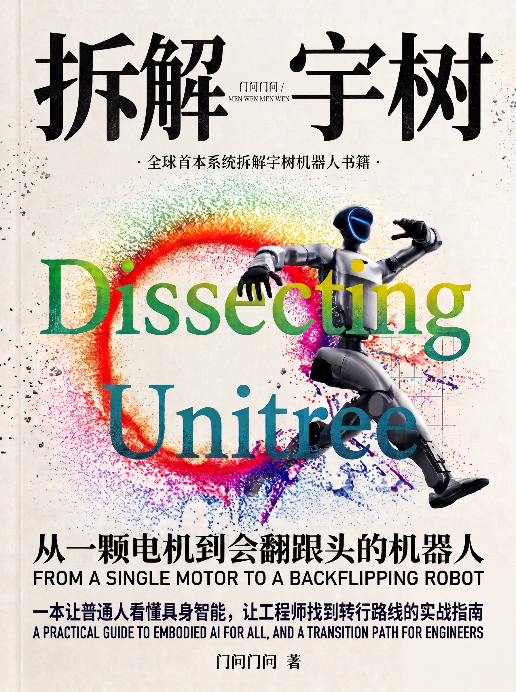
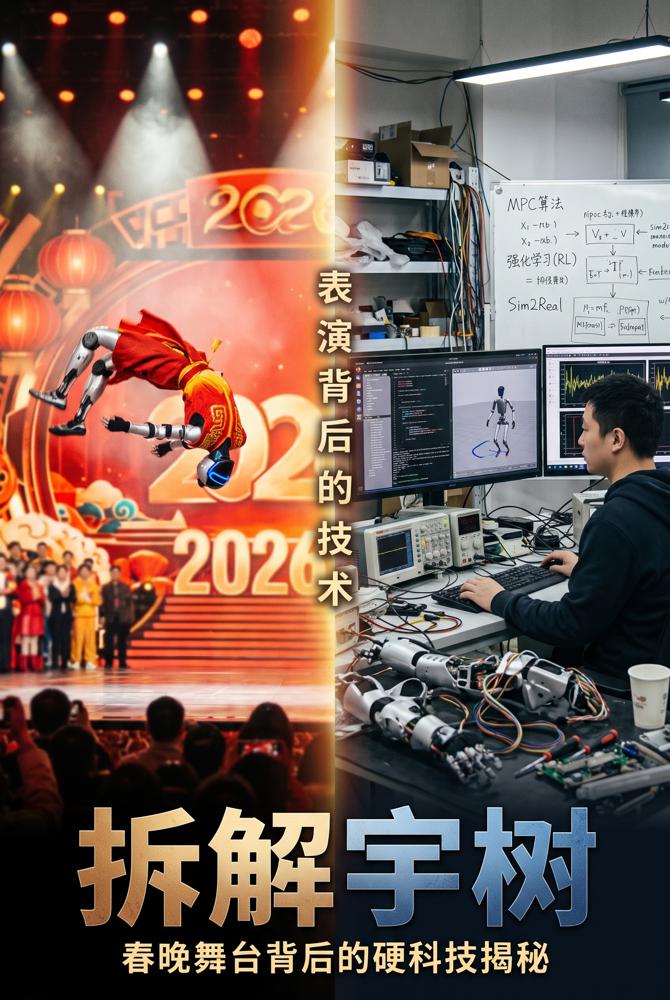
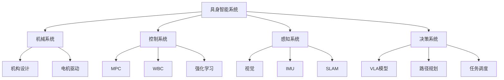

# 全球首本！宇树机器人深度拆解书 🤖

<div align="center">



**一本让普通人看懂具身智能，让工程师找到转行路线的实战指南**

[](LICENSE)
[]()
[]()

</div>

---

## 📖 关于本书

### ❓ 为什么要写这本书？

**JAVA 教程已经满天飞了，怎么一本系统介绍机器人、具身智能的书籍都没有？**

大家怎么了解？怎么学习？怎么入门？

---

## 👨‍💻 作者的转行之路

我大学本科专业是计算机科学，搞纯软的。

刚入学那年听说做程序员很火，钱也不少挣，同时心里也想着做一名程序员，敲着代码，感觉很酷。

### 我的技术栈迭代历程

| 时间节点 | 学习内容 | 当时背景 |
|---------|---------|---------|
| ✨ **大一、大二** | JAVA 后端，SpringBoot 项目（苍穹外卖） | 程序员很火，入门后端开发 |
| ✨ **大二下** | SpringBoot Cloud、JVM 调优 | 就业开始卷，提升技术深度 |
| ✨ **大三上** | Vue3 前端，打算搞全栈 | GPT 3.5、Copilot 初见端倪，xhs、🐂ke 都说后端已死 |
| ✨ **大三中** | STM32、FreeRTOS 嵌入式 | 听说嵌入式比较火，转向硬件 |
| ✨ **大三末** | 南京实习（嵌入式） | Claude Code、Codex 等 Agent 已非常强大 |
| ✨ **现在** | **具身智能** | 纯软被 AI 踹死，转向机器人领域 |

> 💡 **Claude Code 与 Codex 等 agent 已经非常强大了，颇有一股把大部分纯软都踹死的趋势。**

---

## 🎯 这本书适合谁？

### ✅ 六大目标读者群体

1. **🔰 普通人或爱好者**  
   关注 AI、机器人、具身智能，想理解技术原理但缺乏专业背景？

2. **💼 有技术背景的转行者**  
   有软件、电子、机械、自动化背景，想转入机器人行业？

3. **📈 投资者与分析师**  
   关注科技股、硬科技投资，需要深度行业认知？

4. **🎓 在校学生**  
   机械、自动化、计算机、AI 专业，寻找职业方向？

5. **🏭 企业管理者**  
   制造业、物流、服务业管理者，评估机器人应用可行性？

6. **📰 媒体与教育工作者**  
   科技媒体从业者、科学教师、STEM 教育者？

---

## 🌟 核心特色

### ✅ 无门槛的双轨叙事

<table>
<tr>
<td width="50%">

#### 🚶‍♂️ 普通读者轨道
**零基础看懂机器人原理**

- 机器人如何翻跟头？
- 如何端水不洒？
- 如何自主干活？

</td>
<td width="50%">

#### 🏃‍♂️ 工程师轨道
**深度技术实战解析**

- MPC 模型预测控制
- WBC 全身控制器
- Sim2Real 仿真到现实
- 强化学习训练
- VLA 视觉-语言-动作模型

</td>
</tr>
</table>

### 📦 三种可跳过框

- 💡 **工程师视角**：深入技术细节
- 📝 **转行者笔记**：职业发展建议
- 🔧 **动手试试**：实践操作指南

> 根据你的背景和需求，选择性阅读不同模块！

---

## 📂 内容结构

本书通过**拆解宇树机器人**，系统性地讲解具身智能的核心技术：

### 主要章节（参考目录页）

```
第一部分：机器人基础
├── 机械结构设计
├── 电机与驱动系统
└── 传感器融合

第二部分：运动控制
├── 运动学与动力学
├── MPC 模型预测控制
├── WBC 全身控制器
└── 平衡与步态规划

第三部分：感知与决策
├── 视觉感知系统
├── SLAM 定位与建图
└── 强化学习训练

第四部分：具身智能
├── Sim2Real 仿真到现实
├── VLA 多模态模型
└── 人机交互
```

查看完整目录：[目录页截图](目录页+1页正文介绍/)

---

## 📥 下载本书

### 可用格式

- 📄 **PDF 版本**：[拆解宇树-内文.pdf](拆解宇树-内文.pdf)
- 📱 **EPUB 版本**：[拆解宇树.epub](拆解宇树.epub)

### 预览图片

<div align="center">

| 封面 | 目录页 | 内文示例 |
|-----|--------|---------|
|  |  |  |

</div>

更多预览图：[查看介绍图册](宇树插接-介绍图/)

---

## 🛠️ 技术栈覆盖

本书涉及的核心技术领域：



---

## 💪 为什么选择宇树机器人？

- ✅ **国产领先**：宇树科技是全球四足机器人领导者
- ✅ **技术先进**：涵盖运动控制、具身智能前沿技术
- ✅ **资料丰富**：开源社区活跃，便于深度拆解
- ✅ **应用广泛**：工业、救援、巡检等多场景落地

---

## 🤝 贡献与反馈

### 勘误与建议

如果你发现书中有任何错误或有改进建议，欢迎：

- 📧 提交 Issue
- 🔧 提交 Pull Request
- 💬 在 Discussions 中讨论

### 致谢

感谢宇树科技在具身智能领域的开创性工作！

本书整合了大量公开报告、论文和技术文档，向所有为机器人技术发展做出贡献的研究者致敬！

---

## 📜 版权声明

本书采用 [CC BY-NC-SA 4.0](https://creativecommons.org/licenses/by-nc-sa/4.0/deed.zh) 协议发布。

- ✅ 允许：分享、演绎（需署名）
- ❌ 禁止：商业用途
- 🔄 要求：相同方式共享

---

## 🔗 相关资源

### 官方资源

- [宇树科技官网](https://www.unitree.com/)
- [Unitree Robotics GitHub](https://github.com/unitreerobotics)

### 学习资源

- [机器人操作系统 (ROS)](https://www.ros.org/)
- [强化学习圣经 - Sutton & Barto](http://incompleteideas.net/book/the-book.html)
- [现代机器人学 - Kevin Lynch](https://hades.mech.northwestern.edu/index.php/Modern_Robotics)

---

## 🌐 关于作者

一个从 **Java 后端** → **全栈** → **嵌入式** → **具身智能** 的转行者。

用半个月时间，读报告、论文，拆解、整合，呕心沥血完成这本书。

**希望能帮助更多人理解具身智能，找到自己的技术方向！**

---

<div align="center">

**如果这本书对你有帮助，请给个 ⭐ Star！**

Made with ❤️ by 一个转行者

</div>
