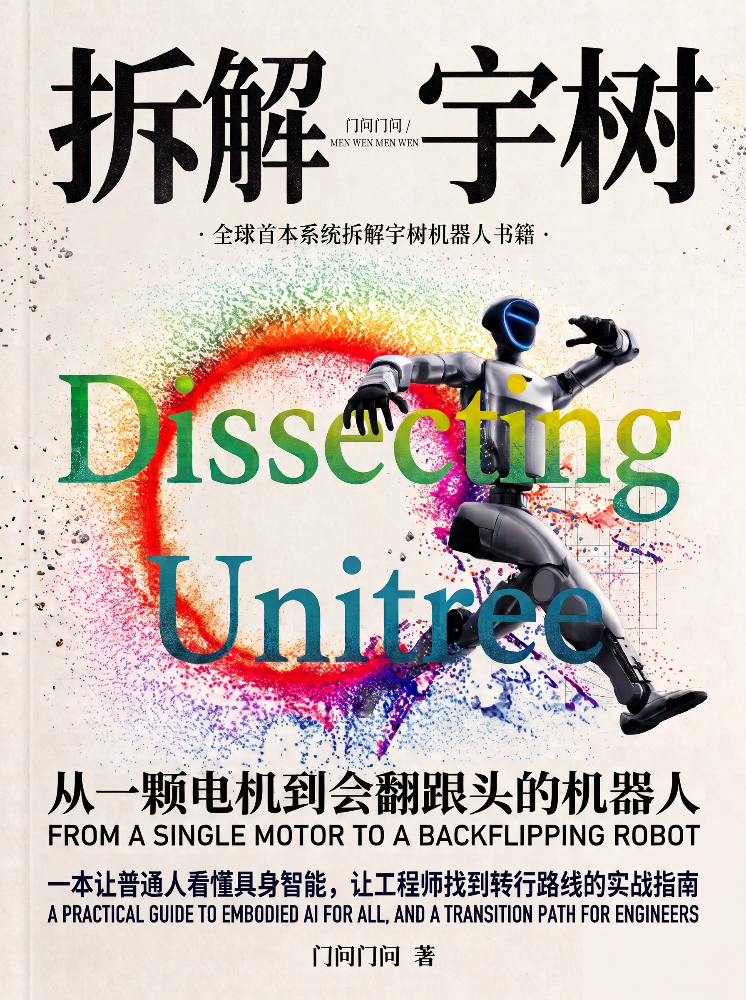
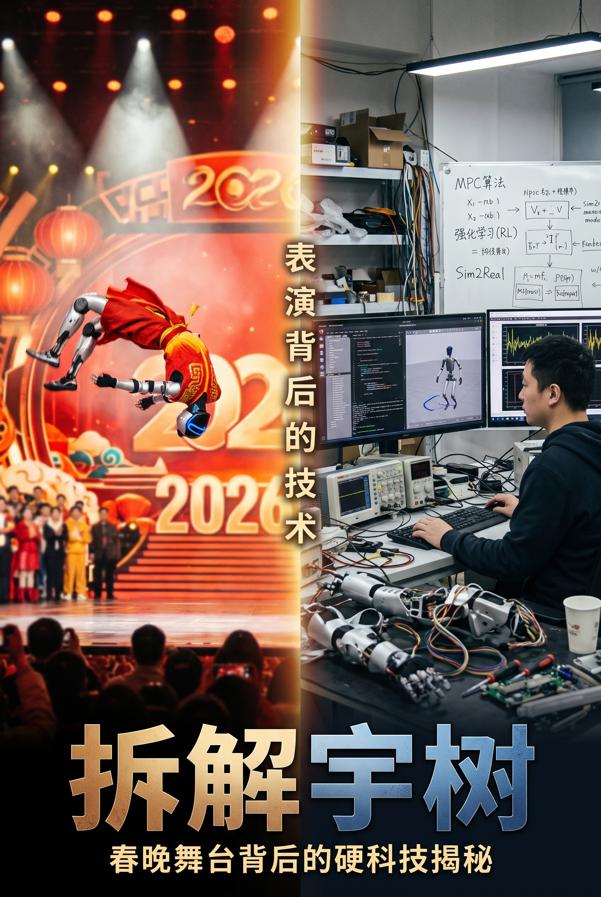
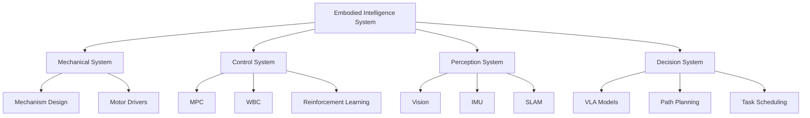

# World's First! In-depth Teardown of Unitree Robotics 🤖

<div align="center">



**A Practical Guide for Ordinary People to Understand Embodied Intelligence and Engineers to Find Career Transitions**

[](LICENSE)
[]()
[]()

[中文版](README.md) | English

</div>

---

## 📖 About This Book

### ❓ Why This Book?

**JAVA tutorials are everywhere, but why isn't there a single systematic book introducing robotics and embodied intelligence?**

How do people learn? How do they get started? How do they understand?

---

## 👨‍💻 Author's Career Transition Journey

I majored in Computer Science, focused on pure software development.

When I entered university, being a programmer was trendy and well-paid. I dreamed of coding like a cool programmer.

### My Tech Stack Evolution

| Timeline | Learning Content | Context |
|----------|------------------|---------|
| ✨ **Year 1-2** | Java Backend, SpringBoot (Cangqiong Delivery Project) | Programming was hot, started backend |
| ✨ **Year 2 End** | SpringBoot Cloud, JVM Tuning | Job market getting competitive |
| ✨ **Year 3 Start** | Vue3 Frontend, Full-stack | GPT 3.5, Copilot emerging; "Backend is dead" |
| ✨ **Year 3 Mid** | STM32, FreeRTOS Embedded | Embedded systems trending |
| ✨ **Year 3 End** | Internship in Nanjing (Embedded) | Claude Code, Codex agents powerful |
| ✨ **Now** | **Embodied Intelligence** | Pure software replaced by AI, pivoting to robotics |

> 💡 **Claude Code and Codex agents are incredibly powerful, seemingly eliminating most pure software jobs.**

---

## 🎯 Who Is This Book For?

### ✅ Six Target Audiences

1. **🔰 General Public or Enthusiasts**  
   Interested in AI, robotics, embodied intelligence, want to understand technical principles without professional background?

2. **💼 Career Transitioners with Tech Background**  
   Background in software, electronics, mechanics, or automation, want to enter robotics?

3. **📈 Investors & Analysts**  
   Focus on tech stocks, hard-tech investments, need deep industry insights?

4. **🎓 University Students**  
   Studying mechanics, automation, computer science, AI, looking for career direction?

5. **🏭 Enterprise Managers**  
   Manufacturing, logistics, service industry leaders evaluating robot application feasibility?

6. **📰 Media & Educators**  
   Tech journalists, science teachers, STEM educators?

---

## 🌟 Core Features

### ✅ Dual-Track Narrative with Zero Barriers

<table>
<tr>
<td width="50%">

#### 🚶‍♂️ General Reader Track
**Understand robot principles from scratch**

- How do robots do backflips?
- How do they carry water without spilling?
- How do they work autonomously?

</td>
<td width="50%">

#### 🏃‍♂️ Engineer Track
**In-depth technical analysis**

- MPC Model Predictive Control
- WBC Whole-Body Controller
- Sim2Real Simulation to Reality
- Reinforcement Learning Training
- VLA Vision-Language-Action Models

</td>
</tr>
</table>

### 📦 Three Types of Optional Boxes

- 💡 **Engineer Perspective**: Deep technical details
- 📝 **Career Transitioner Notes**: Career development advice
- 🔧 **Hands-On Try**: Practical operation guides

> Choose different modules based on your background and needs!

---

## 📂 Content Structure

Through **dismantling Unitree robots**, this book systematically explains core technologies of embodied intelligence:

### Main Chapters (See Table of Contents)

```
Part I: Robot Fundamentals
├── Mechanical Structure Design
├── Motors & Drive Systems
└── Sensor Fusion

Part II: Motion Control
├── Kinematics & Dynamics
├── MPC Model Predictive Control
├── WBC Whole-Body Controller
└── Balance & Gait Planning

Part III: Perception & Decision Making
├── Visual Perception Systems
├── SLAM Localization & Mapping
└── Reinforcement Learning Training

Part IV: Embodied Intelligence
├── Sim2Real Simulation to Reality
├── VLA Multimodal Models
└── Human-Robot Interaction
```

View full table of contents: [Table of Contents Screenshots](目录页+1页正文介绍/)

---

## 📥 Download

### Available Formats

- 📄 **PDF Version**: [拆解宇树-内文.pdf](拆解宇树-内文.pdf)
- 📱 **EPUB Version**: [拆解宇树.epub](拆解宇树.epub)

### Preview Images

<div align="center">

| Cover | Contents | Sample Page |
|-------|----------|-------------|
|  |  |  |

</div>

More previews: [View Gallery](宇树插接-介绍图/)

---

## 🛠️ Technology Stack Coverage

Core technical domains covered in this book:



---

## 💪 Why Unitree Robotics?

- ✅ **Domestic Leader**: Unitree is a global leader in quadruped robotics
- ✅ **Advanced Technology**: Covers cutting-edge motion control and embodied intelligence
- ✅ **Rich Resources**: Active open-source community, ideal for deep analysis
- ✅ **Wide Applications**: Industrial, rescue, inspection, and more

---

## 🤝 Contribution & Feedback

### Errata & Suggestions

If you find any errors or have improvement suggestions:

- 📧 Submit an Issue
- 🔧 Submit a Pull Request
- 💬 Discuss in Discussions

### Acknowledgments

Thanks to Unitree Robotics for pioneering work in embodied intelligence!

This book integrates extensive public reports, papers, and technical documentation. Salute to all researchers contributing to robotics!

---

## 📜 License

This book is published under [CC BY-NC-SA 4.0](https://creativecommons.org/licenses/by-nc-sa/4.0/) license.

- ✅ Allowed: Share, Remix (with attribution)
- ❌ Prohibited: Commercial use
- 🔄 Required: Share-alike

---

## 🔗 Related Resources

### Official Resources

- [Unitree Robotics Official Site](https://www.unitree.com/)
- [Unitree Robotics GitHub](https://github.com/unitreerobotics)

### Learning Resources

- [Robot Operating System (ROS)](https://www.ros.org/)
- [Reinforcement Learning Bible - Sutton & Barto](http://incompleteideas.net/book/the-book.html)
- [Modern Robotics - Kevin Lynch](https://hades.mech.northwestern.edu/index.php/Modern_Robotics)

---

## 🌐 About the Author

A career transitioner from **Java Backend** → **Full-stack** → **Embedded** → **Embodied Intelligence**.

Spent half a month reading reports and papers, dismantling and integrating to complete this heartfelt work.

**Hope to help more people understand embodied intelligence and find their technical direction!**

---

<div align="center">

**If this book helps you, please give it a ⭐ Star!**

Made with ❤️ by A Career Transitioner

</div>
